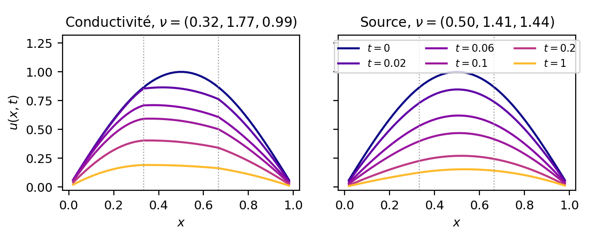
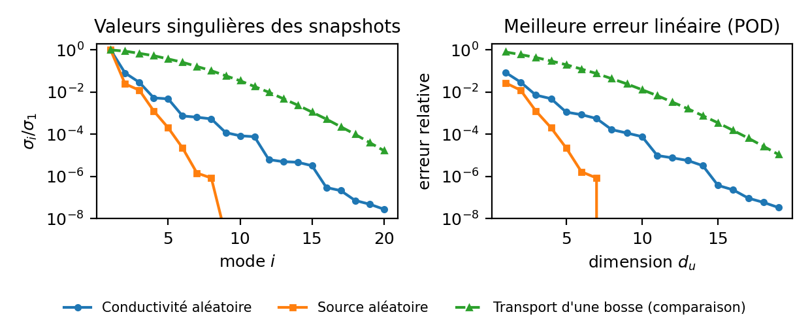
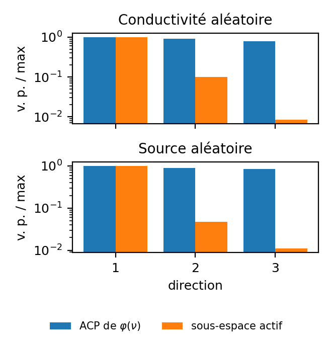
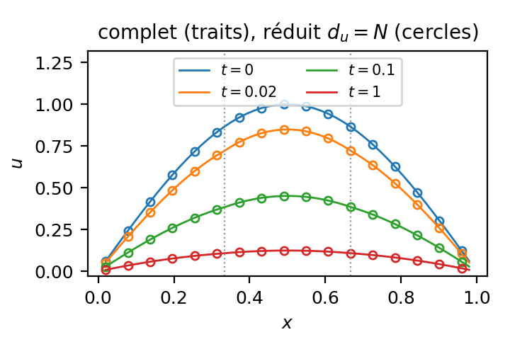
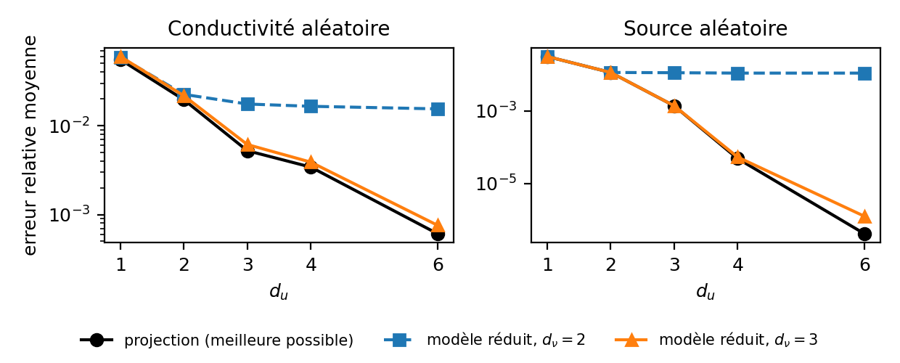
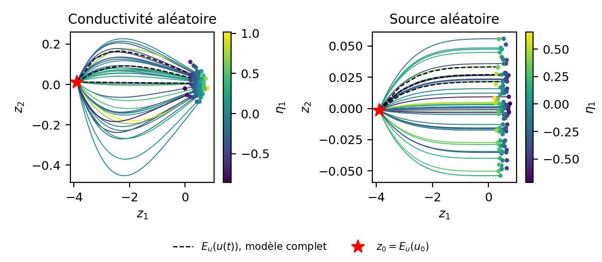
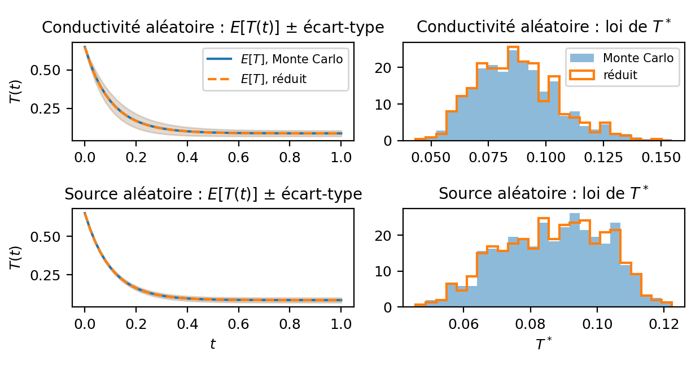

# Modèle réduit à encodeur-décodeur linéaire

*Partie 2, étape 1 du projet : équation de la chaleur 1D à conductivité **ou** source aléatoire.*

Cette note explique ce qui a été construit, pourquoi, comment c'est validé et ce que donnent les premiers résultats.
La présentation associée est [`presentation/reduction_lineaire.pdf`](../presentation/reduction_lineaire.pdf).
Le code est dans [`reduction/lineaire.py`](../reduction/lineaire.py), [`main_reduction.py`](../main_reduction.py) et
[`validation/valid_reduction_lineaire.py`](../validation/valid_reduction_lineaire.py).

---

## 1. Le problème

$$
\partial_t u = \partial_x\big(k(x;\nu)\,\partial_x u\big) + f(x;\nu) \quad \text{sur } ]0,1[, \qquad
u(0) = u(1) = 0, \qquad u(x,0) = \sin(\pi x).
$$

Le domaine est découpé en $M = 3$ zones de même longueur. Deux cas sont traités **séparément** : une seule donnée
est aléatoire, l'autre est fixée à 1.

| Cas | Donnée aléatoire $\nu$ | Donnée fixée |
|---|---|---|
| Conductivité | $k = k_m$ sur la zone $m$, $k_m \sim \mathrm{LogN}(0, 0.3^2)$ i.i.d. | $f = 1$ |
| Source | $f = s_m$ sur la zone $m$, $s_m \sim \mathcal U(0.5, 1.5)$ i.i.d. | $k = 1$ |

**Discrétisation.** Différences finies conservatives sur $N = 50$ nœuds intérieurs, avec la conductivité évaluée au
milieu des mailles. On obtient un système d'EDO

$$
\dot u = A(\nu)\,u + b(\nu), \qquad u \in \mathbb R^{N},
$$

intégré par BDF (`chaleur/modele.py`, `chaleur/solveurs.py`). La partie 1 (`main.py`) propage l'incertitude par
Monte Carlo : 500 tirages de $\nu$, 51 instants dans $[0, 1]$, et l'observable $T = $ température moyenne.

<p align="center"></p>

*Profils $u(x,t)$ pour le matériau le plus contrasté de chaque cas. Les pointillés marquent les interfaces de zones.*

## 2. Objectif de la partie 2 : le schéma réduit

Le support d'Iollo (support de cours) propose de transporter la loi de l'état par l'équation de Liouville. Sur la grille complète, la loi
jointe de $(u, \nu) \in \mathbb R^{N+M}$ demanderait $k^{N+M}$ cellules. Il faut donc **réduire à la fois l'état et
le matériau** :

```
u ∈ R^N ──E_u──► z_u ∈ R^{d_u} ──  ż_u = f(z_u, η)  ──► z_u(t) ──D_u──► u(t) ≈ D_u(z_u(t))
                                          ▲
                 ν ∈ R^M ──E_ν──► η ∈ R^{d_ν}   (matériau fixé en temps)
```

- **Encodeur-décodeur de l'état** : $E_u$, $D_u$, avec $d_u \ll N$.
- **Encodeur du matériau** : $E_\nu$, avec $d_\nu \le M$.
- **Dynamique latente** : $\dot z_u = f(z_u, \eta)$.
- **Partie 3** : pour chaque $\eta$ fixé, $\partial_t p_\eta + \nabla_z\cdot(f\,p_\eta) = 0$. Avec $d_u = d_\nu = 2$,
  c'est une famille de transports en 2D.

**Hypothèse essentielle (support).** Les variables latentes doivent suffire à *prédire* leur propre évolution : une
bonne reconstruction ne suffit pas.

Cette étape construit la version **entièrement linéaire** du schéma. Elle sert de **référence à battre** pour les
encodeurs-décodeurs non linéaires (autoencodeurs convolutifs, U-Net adaptée).

## 3. Pourquoi commencer par un encodeur-décodeur linéaire

### 3.1 Une équation diffusive : régularité et lissage

- $A(\nu)$ est **symétrique définie négative**. Pour $k = 1$, ses valeurs propres valent
  $\lambda_j = -\tfrac{4}{h^2}\sin^2(j\pi h/2) \approx -j^2\pi^2$.
- Le mode $j$ est amorti en $e^{\lambda_j t}$. À $t = 0.02$, les modes $j \ge 5$ sont déjà divisés par
  $e^{-25\pi^2\cdot 0.02} \approx 0.007$. Vers $t \approx 0.1$, il ne reste presque que le premier mode.
- Le semi-groupe de la chaleur est analytique : la solution est **régulière** pour $t > 0$. Dans le cas conductivité,
  elle l'est par morceaux.
- **Il n'y a pas de transport** : aucune structure ne se déplace. En conductivité, $k\,u'$ est continu et $k$ saute,
  donc $u'$ saute aux interfaces. Ces coudes sont cependant **à des positions fixes** ($x = 1/3$, $2/3$). Une base
  linéaire les représente sans difficulté, contrairement à un front mobile.

### 3.2 Une dépendance régulière en $\nu$

- **Source** : $A$ est fixe et $b(s) = \sum_m s_m \chi_m$, donc l'équilibre $u^*(s) = -A^{-1}\sum_m s_m\chi_m$ est
  **affine** en $s$. Les équilibres forment un espace affine de dimension exactement 3, ce qui est vérifié
  numériquement (§6).
- **Conductivité** : $A(k) = \sum_m k_m A_m$ et $u^*(k) = -A(k)^{-1}b$ est une fonction **rationnelle** de $k$. Elle
  est sans pôle tant que $\operatorname{Re} k_m > 0$, donc holomorphe sur un voisinage complexe de l'ensemble des
  paramètres.
- Une dépendance holomorphe implique une décroissance **exponentielle** des $n$-épaisseurs de Kolmogorov de l'ensemble
  des solutions, en $e^{-c\,n^{1/M}}$ pour $M$ paramètres (Cohen et DeVore, 2015). Les meilleurs sous-espaces
  linéaires de dimension $n$ approchent donc très vite toutes les solutions.

### 3.3 Vérification sur les données : pas de barrière de Kolmogorov

<p align="center"></p>

*Spectres POD de nos snapshots, comparés à ceux d'une bosse transportée à vitesse constante sur la même grille (51
instants).*

- Avec 3 modes, l'erreur relative moyenne de projection sur le jeu de test vaut $5\cdot10^{-3}$ (conductivité) et
  $1.4\cdot10^{-3}$ (source).
- La bosse transportée demande environ 10 modes pour atteindre $10^{-2}$. C'est la « barrière de Kolmogorov » des
  problèmes de transport, qui rend les décodeurs non linéaires indispensables (Lee et Carlberg, 2020). Elle est
  absente ici.

### 3.4 Une structure linéaire et affine

- **Linéaire en $u$.** Avec un encodeur linéaire, la projection de Galerkin donne une dynamique réduite **exactement**
  de la forme $\dot z = \hat A z + \hat c$ : la forme de la dynamique latente est connue, il n'y a rien de plus à
  apprendre.
- **Affine en $\nu$.** L'opérateur réduit se calcule à faible coût pour n'importe quel matériau.
- **$A$ symétrique définie négative.** Le modèle réduit hérite de la stabilité (§4.3).

### 3.5 Et les encodeurs-décodeurs profonds ?

La revue bibliographique (U-Net, autoencodeurs convolutifs, opérateurs neuronaux) conduit à deux conclusions.

- **Ils ne se justifient que s'ils battent la référence linéaire**, en particulier à $d_u = 2$.
- **Une U-Net (Ronneberger et al., 2015) telle quelle ne convient pas comme $E_u/D_u$.** Ses connexions de saut transportent les détails de
  chaque échelle de l'encodeur au décodeur (Falck et al., 2022). L'information contourne alors le goulot $z_u$ : la
  reconstruction paraît excellente, mais $z_u$ ne suffit plus à décoder. De plus, au moment de prédire, on ne dispose
  pas des features de $u(t)$.

L'ordre retenu est donc : linéaire d'abord, puis autoencodeur convolutif *sans* sauts depuis l'état.

## 4. L'encodeur-décodeur linéaire

### 4.1 État : POD (autoencodeur linéaire)

On rassemble les snapshots d'apprentissage dans une matrice $X$ : 400 matériaux × 51 instants $= 20\,400$ vecteurs de
$\mathbb R^{50}$. On centre $X$ par sa moyenne $\bar u$, puis on calcule la SVD :

$$
X - \bar u = U\Sigma V^\top, \qquad
E_u(u) = V^\top(u - \bar u), \qquad D_u(z) = \bar u + V z,
$$

où $V \in \mathbb R^{N\times d_u}$ réunit les $d_u$ premiers vecteurs singuliers à droite, avec $V^\top V = I$.

- **Optimalité** (Eckart et Young, 1936). Parmi tous les encodeurs-décodeurs linéaires de rang $d_u$, la POD minimise l'erreur
  quadratique de reconstruction, qui vaut $\sum_{j > d_u}\sigma_j^2$.
- **Lien avec les autoencodeurs.** Un autoencodeur linéaire entraîné par moindres carrés retrouve ce même sous-espace
  (Baldi et Hornik, 1989).
- **Seul choix : $d_u$.** L'apprentissage tient en une SVD.
- **$z_0$ commun.** L'état initial est fixé, donc $z_0 = E_u(u_0)$ est **le même pour tous les matériaux** : toutes
  les trajectoires latentes partent du même point.

Implémentation : classe `POD` ([`reduction/lineaire.py`](../reduction/lineaire.py)). La méthode `avec_dimension(d)`
tronque la base sans refaire la SVD.

### 4.2 Matériau : sous-espace actif

**Pourquoi pas une ACP sur $\nu$ ?** Les $\nu_m$ sont i.i.d., donc leur covariance est (presque) proportionnelle à
l'identité. Les valeurs propres empiriques de la covariance de $\varphi(\nu)$ valent $1 / 0.91 / 0.78$ en conductivité
et $1 / 0.90 / 0.84$ en source : aucune direction n'est négligeable. Une ACP de $\nu$ seul ne réduit rien.

On garde plutôt les directions **qui changent la solution** : c'est le sous-espace actif (Constantine, 2015). On
travaille dans la variable $\varphi(\nu)$ :
- $\varphi = \log k$ en conductivité (variables gaussiennes i.i.d.) ;
- $\varphi = s$ en source.

On définit

$$
J(\nu) = \frac{\partial u^*}{\partial\varphi} \in \mathbb R^{N\times M}, \qquad
C = \mathbb E\big[J^\top J\big] \in \mathbb R^{M\times M}.
$$

$J$ est calculé par différences finies centrées sur l'équilibre `stationnaire`, et $C$ par moyenne sur les 400
matériaux d'apprentissage. Les vecteurs propres dominants de $C$ forment $W \in \mathbb R^{M\times d_\nu}$, et

$$
\eta = E_\nu(\nu) = W^\top\big(\varphi(\nu) - \bar\varphi\big), \qquad
D_\nu(\eta) = \varphi^{-1}\big(\bar\varphi + W\eta\big).
$$

**Directions obtenues** (vecteurs propres de $C$, valeurs propres relatives) :

| | Direction 1 | Direction 2 | Direction 3 |
|---|---|---|---|
| Conductivité ($\log k$) | $(0.71, 0.08, 0.70)$ — 1 | $(0.71, -0.01, -0.71)$ — 0.10 | $(-0.04, 1.00, -0.06)$ — 0.008 |
| Source ($s$) | $(0.39, 0.82, 0.43)$ — 1 | $(-0.68, -0.07, 0.73)$ — 0.048 | $(0.63, -0.57, 0.53)$ — 0.011 |

**Interprétation physique.**
- **Conductivité.** On a $\eta_1 \approx k_1 + k_3$ et $\eta_2 \approx k_1 - k_3$ (en log), tandis que $k_2$ compte
  très peu. À l'équilibre, le flux $q = -k\,u'$ vérifie $q' = f = 1$ et s'annule près du centre (symétrie). La
  sensibilité de $u$ à $k_m$ est pondérée par $|q|$ sur la zone $m$. Or $\int |q|$ vaut $1/9$ sur une zone extérieure
  et $1/36$ sur la zone centrale, soit 4 fois moins.
- **Source.** La zone centrale domine, car la fonction de Green de $-\partial_{xx}$ est maximale au centre. Vient
  ensuite l'antisymétrique $s_3 - s_1$.
- **Bilan pour $d_\nu = 2$.** On garde environ 99 % de la sensibilité, alors que $\nu$ n'est reconstruit qu'à 13 % près
  en moyenne. Ce plancher est inévitable avec trois variables indépendantes, et il est sans importance pour $u$.

<p align="center"></p>

Implémentation : `gradient_equilibre` et classe `SousEspaceActif`.

### 4.3 Dynamique latente : projection de Galerkin

C'est la réduction de modèle par projection classique (Benner et al., 2015). On reconstruit le matériau
$\tilde\nu = D_\nu(\eta)$ et on assemble $A = A(\tilde\nu)$, $b = b(\tilde\nu)$ (méthode
`Chaleur1D.operateur`). La dynamique latente est alors

$$
\dot z = f(z, \eta) = \hat A(\eta)\,z + \hat c(\eta), \qquad \hat A = V^\top A V, \qquad \hat c = V^\top(A\bar u + b).
$$

**Propriétés.**
- **Stabilité garantie.** $\hat A$ est symétrique définie négative, car $A$ l'est et $V$ est orthonormée.
- **Équilibre unique et attractif** : $z^*(\eta) = -\hat A^{-1}\hat c$. C'est le régime asymptotique du support,
  $\mu_\infty \approx \sum_q w_q\,\delta_{z^*(\eta_q)}$.
- **Intégration exacte.** Avec $\hat A = Q\Lambda Q^\top$ (diagonalisation symétrique),
  $z(t) = z^* + Q\,e^{\Lambda t}Q^\top(z_0 - z^*)$. Il n'y a aucune erreur en temps, et $z(t)$ est disponible à
  n'importe quel instant.
- **Lien avec Liouville.** $\nabla_z\cdot f = \operatorname{tr}\hat A(\eta)$ est **constant** pour $\eta$ fixé : la
  densité transportée se contracte à un taux connu. C'est un test exact tout trouvé pour le schéma volumes finis de la
  partie 3.

Implémentation : classe `GalerkinLineaire` (`operateur`, `vitesse`, `equilibre`, `trajectoire`).

### 4.4 Trois sources d'erreur, mesurées séparément

| Erreur | Comment on la mesure | Ce qu'elle teste |
|---|---|---|
| Projection | $u - D_u(E_u(u))$ | richesse de la base POD (borne inférieure) |
| Fermeture | écart entre le modèle réduit et la projection, avec $d_\nu = M$ | l'**hypothèse essentielle** |
| Matériau | $d_\nu = 2$ comparé à $d_\nu = M = 3$ | la réduction de $\nu$ |

On mesure l'erreur relative $\|u - \hat u\|_2/\|u\|_2$ par matériau et par instant, puis on en donne la moyenne et le
maximum sur les **100 matériaux de test**, jamais vus à l'apprentissage.

## 5. Données et protocole

- Les données sont les 500 trajectoires de `main.py` (`resultats/monte_carlo_{cas}.npz`).
- **Apprentissage** : les 400 premiers matériaux, pour la POD et le sous-espace actif.
- **Test** : les 100 suivants.
- **Dimensions étudiées** : $d_u \in \{1, 2, 3, 4, 6\}$ et $d_\nu \in \{2, 3\}$. Le modèle retenu est
  $d_u = d_\nu = 2$, l'exemple du support (Liouville en 2D).
- **Statistiques de $T$** : comparées au Monte Carlo sur les 500 matériaux, de façon appariée (mêmes $\nu$).

## 6. Validation : tests élémentaires

Script : [`validation/valid_reduction_lineaire.py`](../validation/valid_reduction_lineaire.py). Il génère ses propres
données (20 trajectoires par cas) et tourne en 2,6 s. Tous les tests passent dans les deux cas.

| Test | Ce qu'il vérifie | Écart obtenu |
|---|---|---|
| $V^\top V = I$, $E_u(D_u(z)) = z$ | base orthonormée, encodeur inverse à gauche du décodeur | $\le 2\cdot10^{-15}$ |
| Eckart–Young | erreur de projection $= \sum_{j>d}\sigma_j^2$ | $\le 2\cdot10^{-14}$ |
| Rang exact (source) | équilibres reconstruits exactement avec $d = 3$, pas avec $d = 2$ | $3\cdot10^{-16}$ (contre $4\cdot10^{-2}$) |
| Gradient | différences finies comparées au gradient analytique $-A^{-1}[(A(e_m) - A(0))u^* + b(e_m) - b(0)]$ | $7\cdot10^{-10}$ au plus |
| Encodeur du matériau | directions orthonormées, valeurs propres $\ge 0$, $D_\nu(E_\nu(\nu)) = \nu$ si $d_\nu = M$ | $\le 7\cdot10^{-16}$ |
| Galerkin complet | avec $d_u = N$ et $d_\nu = M$, le réduit redonne le modèle complet (trajectoire et équilibre) | $10^{-9}$ (tolérance du BDF), $5\cdot10^{-15}$ |
| Intégration exacte | $z(t)$ égale $z^* + e^{\hat A t}(z_0 - z^*)$, et $f(z^*, \eta) = 0$ | $2\cdot10^{-15}$ |
| Stabilité | $\hat A$ symétrique, $\lambda_{\max}(\hat A) < 0$ pour $d_u = 2$ | $-6.7$ (conductivité), $-9.87 \approx -\pi^2$ (source) |
| Convergence | l'erreur du réduit décroît avec $d_u$ sur des matériaux non vus | oui |

<p align="center"></p>

*Avec toute la base ($d_u = N$), le modèle réduit (cercles) se superpose au modèle complet (traits).*

## 7. Résultats

Script : [`main_reduction.py`](../main_reduction.py), environ 5 s pour les deux cas.

### 7.1 Erreur selon la dimension latente

<p align="center"></p>

| $d_u$ | $d_\nu$ | Conductivité : projection | Conductivité : réduit | Source : projection | Source : réduit |
|---|---|---|---|---|---|
| 1 | 2 | 5.5 % / 18 % | 5.9 % / 25 % | 3.2 % / 9.7 % | 3.2 % / 9.7 % |
| **2** | **2** | 2.0 % / 16 % | **2.2 % / 22 %** | 1.2 % / 4.5 % | **1.2 % / 4.5 %** |
| 3 | 2 | 0.52 % / 2.2 % | 1.8 % / 17 % | 0.14 % / 0.64 % | 1.1 % / 4.6 % |
| 6 | 2 | 0.06 % / 0.21 % | 1.5 % / 17 % | $4\cdot10^{-7}$ | 1.1 % / 4.6 % |
| 2 | 3 | 2.0 % / 16 % | 2.2 % / 24 % | 1.2 % / 4.5 % | 1.2 % / 4.5 % |
| 3 | 3 | 0.52 % / 2.2 % | 0.61 % / 2.8 % | 0.14 % / 0.64 % | 0.14 % / 0.64 % |
| 4 | 3 | 0.34 % / 1.5 % | 0.39 % / 1.8 % | $5\cdot10^{-5}$ | $5\cdot10^{-5}$ |
| 6 | 3 | 0.06 % / 0.21 % | 0.08 % / 0.33 % | $4\cdot10^{-7}$ | $1\cdot10^{-6}$ |

*Erreur relative moyenne / maximale sur les 100 matériaux de test et les 51 instants. En gras : le modèle retenu.*

**Lecture.**
1. **La fermeture est vérifiée.** Avec $d_\nu = 3$ (matériau non réduit), l'erreur du modèle réduit colle à la
   meilleure erreur possible (projection) : 0.61 % contre 0.52 % en conductivité à $d_u = 3$, valeurs identiques en
   source. Dans le cas linéaire, les variables latentes suffisent à prédire leur évolution : l'hypothèse essentielle
   du support est satisfaite.
2. **Avec $d_\nu = 2$, c'est la réduction du matériau qui limite.** L'erreur plafonne vers 1.5 % (conductivité) et
   1.1 % (source), quel que soit $d_u$.
3. **Pour $d_u = d_\nu = 2$, l'erreur moyenne est de 2.2 % et 1.2 %.** Le maximum de 22 % en conductivité vient de
   matériaux très contrastés, par exemple $k = (2.43, 0.53, 1.84)$. Il persiste jusqu'à l'équilibre (21 % pour
   $t \ge 0.2$) : avec 2 modes, la base ne suit pas la forme du profil. C'est précisément là qu'un décodeur non
   linéaire peut gagner.

### 7.2 Plan latent $(z_1, z_2)$

<p align="center"></p>

Ce plan montre déjà la structure de la future Liouville :
- toutes les trajectoires partent du même $z_0 = E_u(u_0)$ et rejoignent leur équilibre $z^*(\eta)$ ;
- le nuage des équilibres est l'image de l'incertitude matérielle, $\mu_\infty \approx \sum_q w_q\,\delta_{z^*(\eta_q)}$ ;
- les pointillés représentent le modèle complet encodé, $E_u(u(t))$. Ils se superposent aux trajectoires réduites :
  c'est la fermeture du §7.1, vue dans le plan.

### 7.3 Propagation de l'incertitude : comparaison au Monte Carlo

<p align="center"></p>

| ($d_u = d_\nu = 2$, 500 matériaux) | $E[T^*]$ Monte Carlo | $E[T^*]$ réduit | Écart / demi-largeur de l'IC 95 % | Écart-type MC / réduit |
|---|---|---|---|---|
| Conductivité | 0.0874 ± 0.0016 | 0.0870 | 0.23 | 0.0180 / 0.0174 |
| Source | 0.0868 ± 0.0014 | 0.0868 | 0.03 | 0.0154 / 0.0153 |

- **Accord avec le Monte Carlo.** Pour $t > 0$, le plus grand écart sur $E[T(t)]$ vaut $1.3\cdot10^{-3}$ en
  conductivité ($t = 0.12$), face à un IC de $4.6\cdot10^{-3}$, et $2.5\cdot10^{-4}$ en source ($t = 0.04$), face à
  $4.5\cdot10^{-4}$. Les écarts restent donc dans l'intervalle de confiance du Monte Carlo.
- **À $t = 0$, une petite erreur fixe.** L'état initial décodé diffère de $u_0$ de 0.5 % (conductivité) et 0.3 %
  (source), puisque $u_0$ n'appartient pas exactement à la base à 2 modes.
- **Coût en ligne** : environ 15 ms par matériau pour le modèle complet (BDF), contre 0.2 ms pour le modèle réduit,
  soit environ 75 fois moins.

## 8. Bilan et suite

**Bilan.**
- L'équation est **diffusive** et dépend **régulièrement** de $\nu$ : la réduction linéaire est quasi optimale.
  3 modes suffisent pour passer sous 1 % d'erreur.
- **L'encodeur-décodeur linéaire est complet** : POD pour l'état, sous-espace actif pour le matériau, Galerkin pour la
  dynamique. Il est stable par construction et intégré exactement.
- **L'hypothèse essentielle est vérifiée** dans le cas linéaire : l'erreur du réduit est très proche de l'erreur de
  projection.
- **Le modèle retenu ($d_u = d_\nu = 2$)** fait 2.2 % (conductivité) et 1.2 % (source) d'erreur moyenne. Les
  statistiques de $T$ restent dans l'IC du Monte Carlo, pour un coût environ 75 fois plus faible.
- **Limites** : le plateau dû à $d_\nu = 2$, et les matériaux très contrastés en conductivité (22 % au maximum).

**Suite.**
1. **Encodeur-décodeur non linéaire** : autoencodeur convolutif 1D (Lee et Carlberg, 2020), de type U-Net *sans*
   sauts depuis l'état (Falck et al., 2022), avec un
   décodeur éventuellement conditionné par $\eta$. Cible à battre à $d_u = 2$ : 2.2 % / 22 % en conductivité.
2. **Encodeur du matériau non linéaire**, appris à travers la dynamique avec des pertes sur les dérivées latentes
   (Champion et al., 2019), pour lever le plateau dû à $d_\nu = 2$.
3. **Liouville réduite (partie 3)** : volumes finis dans le plan $(z_1, z_2)$ pour chaque $\eta_q$, à partir de
   `resultats/reduction_lineaire_{cas}.npz`. Le fait que $\nabla_z\cdot f = \operatorname{tr}\hat A$ soit constant
   fournit un test exact.

## 9. Reproduire

```bash
python3 main.py                                  # Monte Carlo (partie 1), écrit resultats/monte_carlo_*.npz
python3 validation/valid_reduction_lineaire.py   # tests élémentaires de la réduction linéaire
python3 main_reduction.py                        # résultats, resultats/reduction_lineaire_*.{png,npz}
python3 presentation/figures.py                  # figures de la présentation et de cette note
cd presentation && pdflatex reduction_lineaire.tex && pdflatex reduction_lineaire.tex
```

| Fichier | Rôle |
|---|---|
| [`chaleur/cas.py`](../chaleur/cas.py) | les deux cas : données, lois, variable $\varphi(\nu)$ |
| [`reduction/lineaire.py`](../reduction/lineaire.py) | `POD`, `gradient_equilibre`, `SousEspaceActif`, `GalerkinLineaire` |
| [`reduction/affichage.py`](../reduction/affichage.py) | figure de synthèse de `main_reduction.py` |
| [`main_reduction.py`](../main_reduction.py) | apprentissage, étude des dimensions, comparaison au Monte Carlo, sauvegardes |
| [`validation/valid_reduction_lineaire.py`](../validation/valid_reduction_lineaire.py) | tests élémentaires |
| [`presentation/figures.py`](../presentation/figures.py) | figures au format diapositive (pdf et png) |
| [`presentation/reduction_lineaire.tex`](../presentation/reduction_lineaire.tex) | présentation Beamer |

Le fichier `resultats/reduction_lineaire_{cas}.npz` contient :
- les briques du modèle : $\bar u$, $V$, $W$, $\bar\varphi$ ;
- les matériaux latents $\eta$ et le point de départ $z_0$ ;
- les trajectoires latentes, sur la grille de sortie et sur une grille fine ;
- les équilibres $z^*$ ;
- les spectres, le tableau d'erreurs et les coûts.

## Références

- A. Iollo, *Réduction d'incertitude par l'équation de Liouville*, support de cours.
- P. Benner, S. Gugercin, K. Willcox, A survey of projection-based model reduction methods for parametric dynamical
  systems, *SIAM Review* 57(4):483–531, 2015. <https://doi.org/10.1137/130932715>
- A. Cohen, R. DeVore, Approximation of high-dimensional parametric PDEs, *Acta Numerica* 24:1–159, 2015.
  <https://arxiv.org/abs/1502.06797>
- C. Eckart, G. Young, The approximation of one matrix by another of lower rank, *Psychometrika* 1(3):211–218, 1936.
  <https://doi.org/10.1007/BF02288367>
- P. G. Constantine, *Active Subspaces: Emerging Ideas for Dimension Reduction in Parameter Studies*, SIAM, 2015.
  <https://doi.org/10.1137/1.9781611973860>
- P. Baldi, K. Hornik, Neural networks and principal component analysis: learning from examples without local minima,
  *Neural Networks* 2(1):53–58, 1989. <https://doi.org/10.1016/0893-6080(89)90014-2>
- K. Lee, K. Carlberg, Model reduction of dynamical systems on nonlinear manifolds using deep convolutional
  autoencoders, *J. Comput. Phys.* 404:108973, 2020. <https://arxiv.org/abs/1812.08373>
- O. Ronneberger, P. Fischer, T. Brox, U-Net: Convolutional networks for biomedical image segmentation, *MICCAI*, 2015.
  <https://arxiv.org/abs/1505.04597>
- F. Falck et al., A multi-resolution framework for U-Nets with applications to hierarchical VAEs, *NeurIPS*, 2022.
  <https://arxiv.org/abs/2301.08187>
- K. Champion, B. Lusch, J. N. Kutz, S. L. Brunton, Data-driven discovery of coordinates and governing equations,
  *PNAS* 116(45):22445–22451, 2019. <https://doi.org/10.1073/pnas.1906995116>
